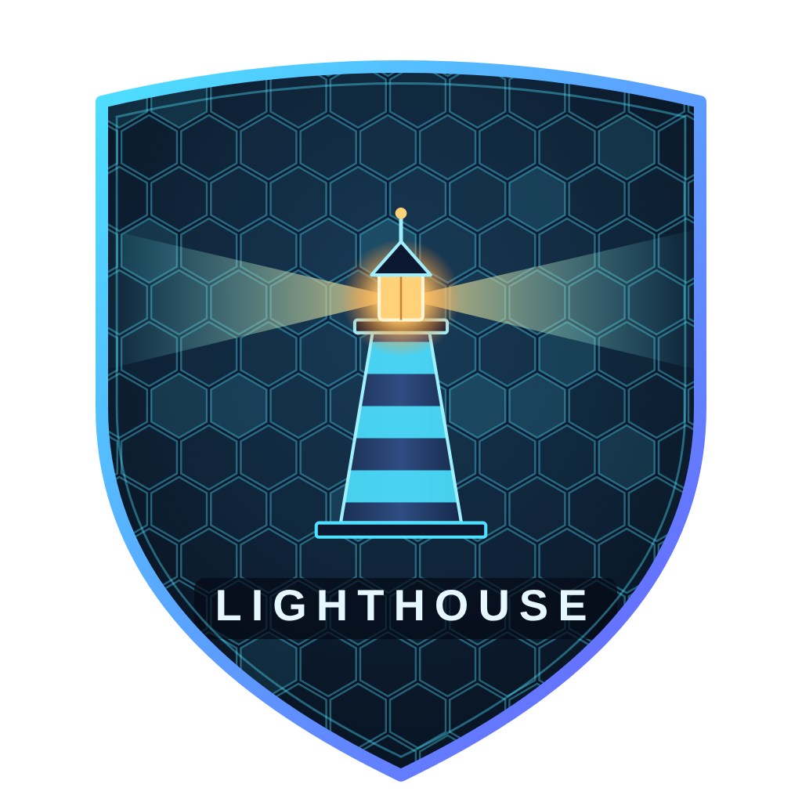

<p align="center">
  
</p>

<h1 align="center">Lighthouse</h1>

<p align="center">
  A futuristic first-person shooter with base defence, built in Godot for Android.
</p>

---

## About

You are an operative of a secret agency whose home base is a lighthouse. Inside it sits the power core that drives the planet. Bio-mechanical aliens from beyond Earth are invading, because they feed on that core.

Missions take you out into the world, but the base can be attacked at any moment. Defend it or finish the mission: you can only pick one, and every choice has consequences for your rank. You can also launch a fighter jet from the base hangar to fight in the sky.

## Status

Planning phase. The design is settled and no game code exists yet.

## Tech

- Engine: Godot 4 (Mobile renderer)
- Language: GDScript
- First platform: Android

## Getting started

1. Install Godot 4.3 or newer (standard version, not .NET).
2. Open Godot, choose Import, and select `project.godot`.
3. Press F5 to run. The Stage 1 test screen shows rank, qubits and base health, with buttons to try the game state.

## Project structure

```
autoload/    global singletons (game manager, event bus)
scenes/      player, weapons, enemies, jet, base, colonies, missions, levels, ui
scripts/     shared code not tied to one scene
assets/      models, textures, fonts, icons, logo
audio/       music, sfx, radio
data/        ranks, mission and enemy stats
```

## Logo

The logo lives at `assets/logo/logo.png`. Replace that file with the final version and the image at the top of this README updates automatically.

## License

To be decided (personal or open source).
